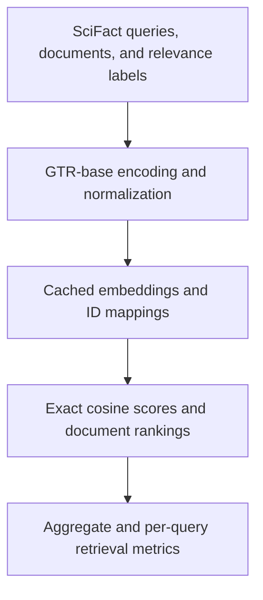

# Privacy and Retrieval Quality in Text Embeddings
### Which queries remain reliable when Gaussian noise is added?

**Ongoing CSC2229 final project · Privacy-Enhancing Technologies · University of Toronto**

## Project Overview

Text embeddings let search systems find documents by meaning rather than exact keyword matches. This project explores a privacy question around those stored representations: if we add Gaussian noise to document embeddings, how much retrieval quality do we lose, and does that loss affect every query equally?

The central research question is:

> Which queries preserve their retrieval quality when Gaussian noise is added to stored embeddings, and which ones break?

The project combines a dense retrieval pipeline with query-level analysis. It will investigate whether the gap between relevant and irrelevant documents, together with the number of close competitors, can help predict retrieval failures.

The clean retrieval baseline is complete. Noise experiments, analytical modeling, and privacy evaluation are the next stages.

## Current Progress

| Component | Status |
| --- | --- |
| SciFact loading and GTR-base embedding generation | Completed |
| Exact cosine retrieval and clean baseline evaluation | Completed |
| Cached similarity scores, full rankings, and per-query metrics | Completed |
| Query geometry and analytical failure model | Next stage |
| Repeated Gaussian-noise retrieval experiments | Planned |
| Differential privacy analysis and Vec2Text evaluation | Planned |
| Query-level failure prediction | Planned |

## Baseline Setup

- **Dataset:** SciFact, loaded through BEIR.
- **Evaluation set:** 300 queries and 5,183 documents.
- **Embedding model:** `sentence-transformers/gtr-t5-base`.
- **Representation:** 768-dimensional, L2-normalized query and document embeddings.
- **Retrieval:** Exact cosine similarity over the full document collection.

The embedding pipeline uses the complete SentenceTransformer model, including its pooling, dense projection, and normalization layers. Embeddings and ID mappings are cached so later experiments can reuse the same baseline.

## Implemented Pipeline

The planned extension will perturb stored document embeddings, rerun retrieval across noise trials, and compare observed failures with predictions from clean retrieval geometry.

## Clean Retrieval Results

These results establish the reference point before noise is added.

| Metric | Score |
| --- | ---: |
| Recall@1 | 0.4565 |
| Recall@5 | 0.6468 |
| Recall@10 | 0.7243 |
| Hit@1 | 0.4833 |
| Hit@5 | 0.6667 |
| Hit@10 | 0.7400 |
| MRR | 0.5726 |
| MRR@10 | 0.5664 |
| NDCG@10 | 0.5974 |

**Hit@10 = 0.7400** means that 222 of the 300 queries retrieve at least one relevant document in their clean Top-10 results. Recall@10 measures the fraction of relevant documents retrieved, averaged across queries; it is a different measure from Hit@10.

For the main noise-induced failure analysis, these 222 clean-success queries form the initial Top-10 robustness cohort. Queries that already fail before noise is added will be considered separately.

## Why Analyze Individual Queries?

An average retrieval score can summarize overall degradation, but it does not explain which queries are affected or why.

Two queries may have the same clean retrieval outcome while having very different score distributions. One might have a relevant document clearly ahead of its competitors; another might have several irrelevant documents with almost identical scores.

The project will examine two main signals:

- **Retrieval margin:** How far the best-scoring relevant document is above or below the competing Top-k boundary.
- **Noise-aware competitive density:** How many irrelevant documents have scores close enough to compete at a given noise level.

The completed baseline already stores the similarity scores, rankings, and relevance information needed for this analysis. Whether these signals predict robustness remains an open experimental question.

## Next Experiments

1. **Compute query geometry.** Calculate signed margins for Top-1, Top-5, and Top-10, and examine margins relative to the noise scale.
2. **Measure noise-induced failures.** Add Gaussian noise to stored document embeddings and repeat retrieval over multiple trials and noise levels.
3. **Compare theory with observations.** Evaluate a Gaussian pairwise score-crossing model and a Top-k boundary approximation against empirical failures. A boundary approximation will not be treated as an exact Top-k failure probability.
4. **Evaluate privacy separately.** Specify the threat model and privacy accounting, then investigate text reconstruction with Vec2Text alongside retrieval utility.
5. **Predict vulnerable queries.** Assess whether margin and density features can explain or predict failure, including through logistic regression.

For empirical Top-k failure, the target event is that no relevant document remains in the Top-k. This distinction matters for queries with multiple relevant documents.

## Technical Focus

- **Retrieval engineering:** Batched embedding generation, reusable caches, exact similarity search, and ranking.
- **Evaluation:** Aggregate and query-level Recall, Hit Rate, MRR, and NDCG.
- **Analysis:** Connecting retrieval geometry with sensitivity to noise.
- **Privacy research:** Studying utility loss alongside an explicit privacy model and reconstruction evaluation.

**Tools:** Python, NumPy, PyTorch, SentenceTransformers, and BEIR.

## Scope and Limitations

The current results are a clean retrieval baseline on one dataset. They do not yet demonstrate robustness to Gaussian noise, resistance to reconstruction, or a differential privacy guarantee. The proposed geometry signals and failure model still require empirical validation.

The broader goal is to understand which queries are vulnerable under a given noise setting and provide evidence for future work on privacy-aware retrieval.

## Source Code and Data

This repository provides a public overview of the project, its baseline results, and planned experiments. The full implementation is maintained in a private repository.

Dataset copies, embedding caches, full similarity matrices, and query-level experiment outputs are not distributed in this showcase.

